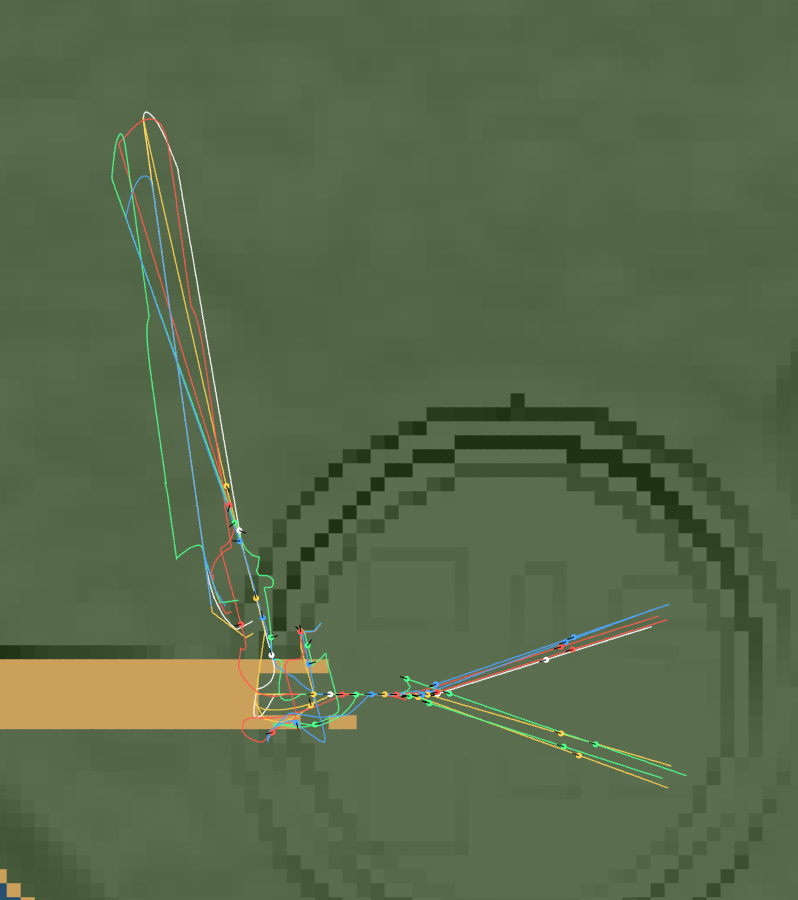
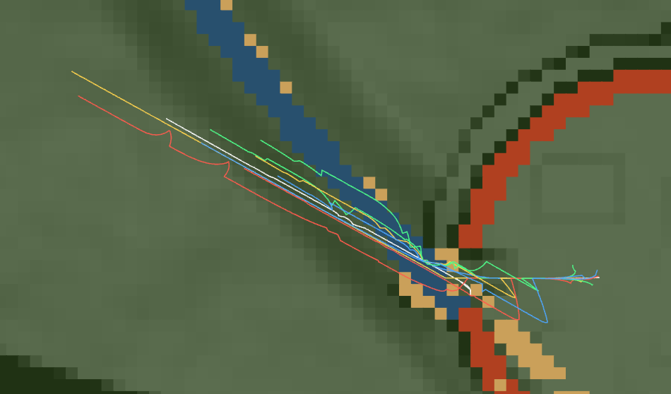
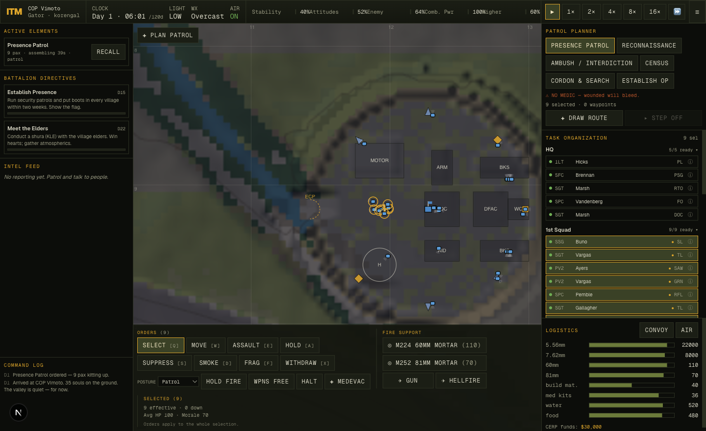
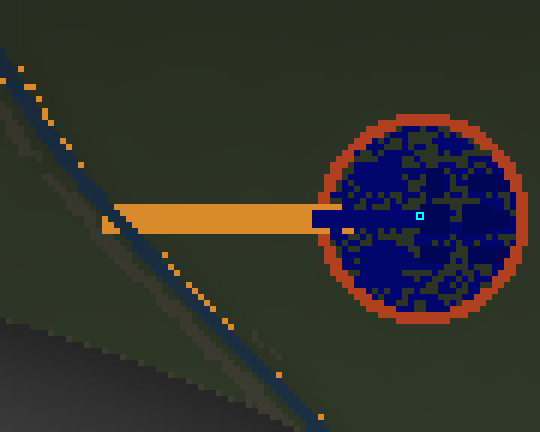
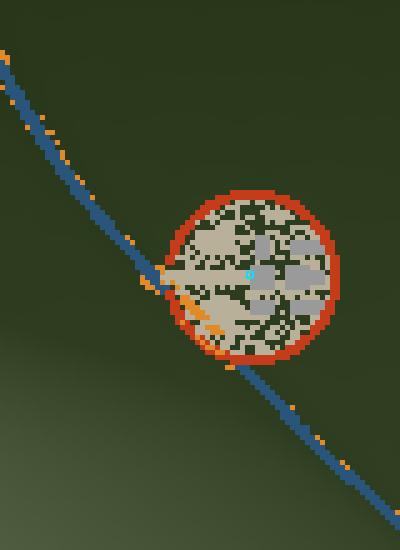
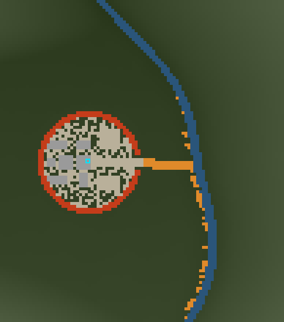

# 2026-06-03 — Authentic squad movement & a real COP access road

Two passes at fidelity: how a squad *traces* the ground, and how a combat outpost is *sited and
reached*. Both were partly artifacts of the earlier closed-loop-movement rework.

## Squad movement — trace, don't pose

**Before:** followers were placed at rigid geometric offsets from the leader's *instantaneous
heading*, so every time the point man turned, the whole formation rotated like a turnstile — men cut
chords across each other and constantly swapped lanes. The pace governor was a binary freeze: over
one 560 m route the point man **dead-stopped ~12% of the time**, producing a visible stutter.

**After:** the navigator's real route is recorded as a breadcrumb (`Task.trail`); each man keeps to
it a set distance back, with a lateral offset taken from the **local trail tangent** (so the file
opens into a fire-team wedge in the open and collapses to single file at a choke). The squad now
moves as a coherent bundle of parallel traces that hold their lanes — tightening at the river
crossing and spreading after — and the point man **eases the throttle** (`Unit.paceScale`, smooth,
never a dead stop) instead of freezing. Same route: **0% navigator dead-stops.**

This also fixed a latent **gate-egress stall** (reproduced on the pre-change code too): the file-out
backstop measured the lagging squad centroid, so it flipped to formation while the point man was
still inside the wire, then tangled on the HESCO. It now watches the point man and lets him pour
through the ECP at full pace.

## COP — sited and reached like a real outpost

**Before:** placement scoring rewarded raw height, so the COP often landed on a ~250 m alpine perch
~320 m from the valley; a straight cut-and-fill grader then lerped elevation in one shot, gouging a
**25 m-wide, ~320 m-long trench at ~78% average grade** across the hillside — the "ramp that goes on
forever, all the way to the river."

**After:** the COP is sited like the real Korengal Outpost — a commanding bench/low spur a few tens
of metres above the valley floor, close enough to be supplied by road. `gradeAccessRoad` then routes
a **narrow, switchbacked track one short step at a time, following the terrain** — heading for the
valley where the grade allows, traversing/switchbacking where the fall line is too steep, and
reshaping the ground only enough to keep the tread walkable. Carved footprint dropped ~**14×**.

## Verification

- `npm run build` ✓ · `npx tsc --noEmit` ✓
- `scripts/balance.ts 16 45` — ✓ no elements left stranded; contacts 12/16, US KIA ~0.44
- `scripts/copsurvey.ts` — egress reachable in every seed; commanding relief 33–57 m, ~95–185 m off
  the road; bulldozed footprint 6213 → ~450 m²
- `scripts/egress.ts` — point man clears the wire in every seed tested (incl. the previously-stuck
  survey-9)
