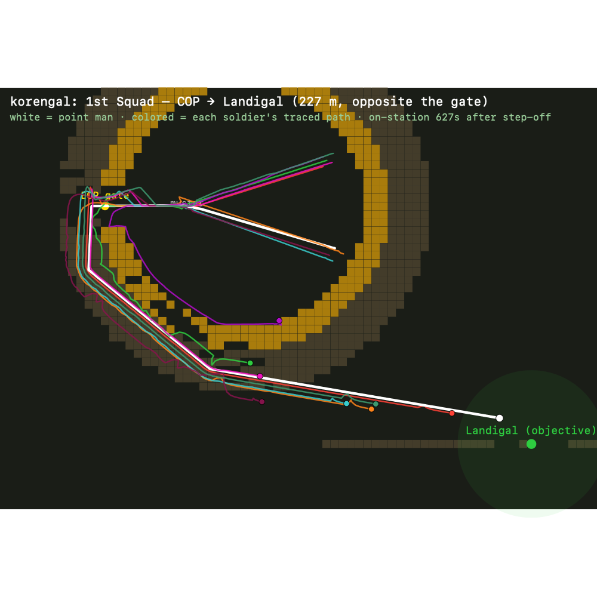

# 2026-06-03 — Squad movement rebuilt: "navigate globally, steer locally"

Follow-on to [the morning's movement/COP pass](2026-06-03-movement-and-cop-road.md). A player report —
*"moved a squad from inside the COP to the village just to the right; it hugged the perimeter, bumped the
wire, and finished the mission without ever reaching the village"* — turned out to hide **four** layered
bugs. Full write-up with diagrams and screenshots: **[2026-06-03-movement-report.html](2026-06-03-movement-report.html)**.

## The four root causes (and fixes)

1. **No local avoidance / separation.** Followers beelined at a slot or the man ahead; around the convex
   HESCO ring both lines clip the wall, and bodies interpenetrated. → A context/fan **steering layer**
   (`lib/sim/steering.ts`) in `combat.ts moveUnit`: rounds obstacles, separates bodies, no-op in the open.
2. **Dishonest progress metric.** The leg backstop measured crow-flies distance to the objective, which
   *grows* as you round a convex obstacle → fired mid-march and froze the squad ("finished without
   arriving"). → Measure the navigator's **remaining route length** (`world/tasks.ts`), monotonic as he
   advances; a stuck patrol sets up where it actually is, never faking arrival.
3. **Global route tunnelled through the outpost.** A 2-cell wall is invisible at 15 m coarse nodes (each
   still ~7 passable apron cells), so A* cut through the yard ("waypoints inside that hopped the walls"),
   a 227 m village → 555 m winding route. → **Thicken the wall to ≥3 cells** + a quadratic **barrier
   penalty** on coarse nodes carrying wall/cliff cells (`path.ts`) so the ring seals and routes go around.
4. **Formation too wide for the corridor; orphans inside the wire.** → **Corridor-aware width** (sense the
   free width, collapse the wedge to file at a choke), followers **trace the leader's breadcrumb** as a
   walkable path, and a separated man **rejoins through the gate** with a real A* route (`world/formation.ts`).
   Plus a **benched perimeter track** ringing the COP (`terrain.ts`) so there's a cheap way around.

## Verification

- `npx tsc --noEmit` ✓ · `npm run build` ✓
- `scripts/balance.ts 16 45` — ✓ no elements stranded mid-route; firefights 13/16 (combat intact)
- `scripts/smoke.ts` — full patrol cycle (out the gate → objective → back inside the wire)
- `scripts/movement-diag.ts` (new reproduction harness) — worst-case "village opposite the gate" now sets
  up *on the objective* in 5/7 stress seeds (was 2/7), **including `korengal`, the player's default seed**
- `scripts/trajectory-svg.ts` (new) — renders the squad's actual traced path around the wire (see report)

## Known follow-ups (honest)

- Two synthetic stress-seeds remain imperfect: one whose gate faces a cliff, one whose squad starts deep
  among interior buildings and dead-locks in the cramped yard — both COP-*siting* edge cases, not movement.
- Balance shows higher patrol casualties than before — an expected consequence of patrols now *actually
  reaching* contested objectives instead of stalling near the wire; enemy-ambush timing is the tuning knob.
