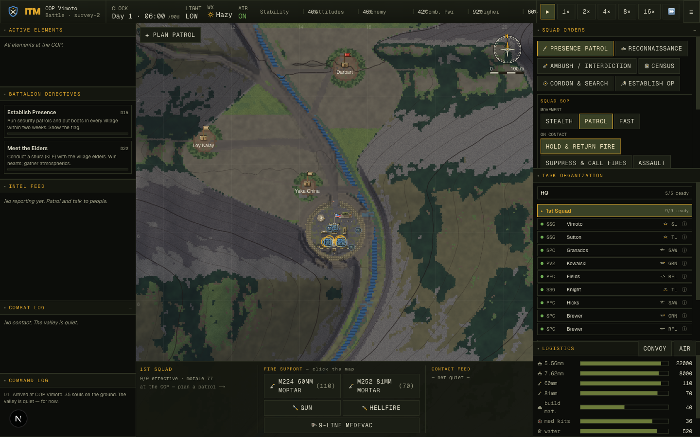
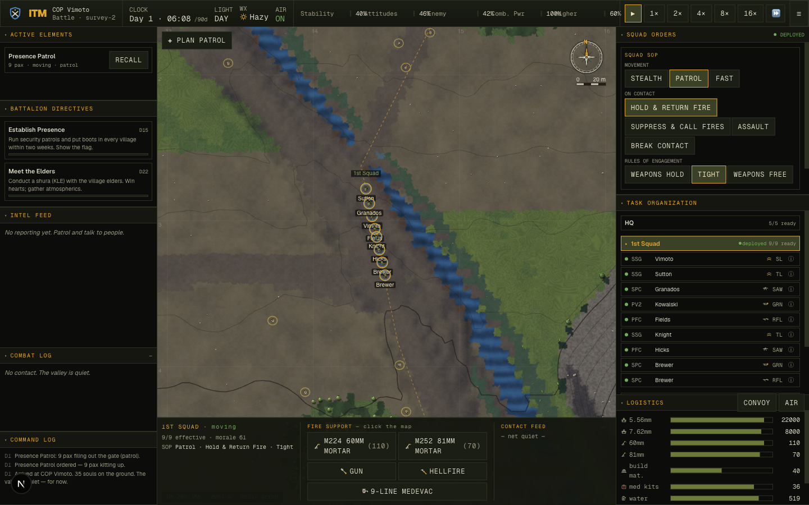
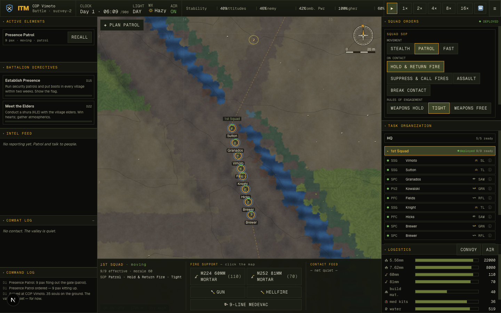

# Navigation overhaul — the river is a real obstacle, not a chasm (2026-06-06)

**Goal:** make navigation and world interaction feel like real-life military movement — soldiers and
squads should reliably reach objectives, cross the river *at crossings*, and never get stranded.

We followed the project's verify-don't-assume doctrine: turn the fuzzy complaint into hard numbers
with a headless harness, capture a baseline, fix the root cause, and re-measure. A multi-agent
**stuck-case hunt workflow** ran in parallel to find the stranding classes the point-man harnesses
missed, and wrote the reproduction probes used below.

## The root cause (measured, not guessed)

A new fast static structural audit (`scripts/terrain-audit.ts`, 40 seeds, no sim) found the valley
floor was structurally broken — the river ran in a deeply-incised, **cliff-walled chasm with zero
crossings**, and in **28% of seeds the two banks were in separate passable components** (you could
not walk across the valley at all). Everything downstream — unreachable villages, "stuck on the
river", routers giving up — followed from that.

## What changed

1. **A walkable floodplain.** `carveFloodplain` benches a continuous, gentle valley floor around the
   river, killing the incision cliffs and the trap cells.
2. **The river is a real obstacle, crossed at fords & footbridges.** `Land.River` is now impassable;
   a new `Land.Ford` (shallow gravel-bar crossing — slow, exposed) plus footbridges are the only ways
   over. `placeFords` lays them every ~260 m and `ensureRiverCrossings` guarantees the banks join.
3. **A river-aware foot planner.** The coarse global plan treats the channel as a real barrier (so it
   routes to crossings); a free, unclipped A* fallback finds long ford-detour routes the corridor
   can't contain; and objectives snap to a cell in the squad's *own* connected component (never the
   far bank).
4. **Whole-squad movement.** The squad sets up on station only once it has *closed up* (not the
   instant the point man arrives); the return files back in keyed on the lead reaching the gate (so it
   no longer stands down outside the wire); and altitude fatigue only drags when actually climbing.

## Before → after (verified)

Static structural audit — `scripts/terrain-audit.ts`, 40 seeds (mover-faithful ground truth):

| metric | before | after |
|---|---:|---:|
| river bank-cliff fraction | 59% | **1%** |
| river "trap" cells (stuck-in-river) | 5,296 | **0** |
| seeds with the two banks SPLIT | 28% | **0%** |
| villages BFS-unreachable | 18% | **2%** (genuine cliff pockets, honest) |
| router NULL routes to villages | 30% | **2%** (≈ the cliff-pocket villages; squad sets up as close as the ground allows) |
| far reachable objectives missed by router | 20% | **0.4%** |
| crossings present | 0 | ~70–140 / seed |

(Full 60-seed figures, verified independently on the fresh survey-40..59 tail.)

Whole-squad behaviour — `scripts/squad-arrival.ts`, combat-free, 6 seeds × nearest villages:

| metric | before | after |
|---|---:|---:|
| RETURN home (≥60% inside the wire) | 23–36% | **81%** |
| squad cohesion @ objective (whole element) | unmeasured | **94%** (88% of squads ≥70% closed up) |
| arrival (vs snapped objective) | — | **89%** |
| watchdog identical re-plans (`thrash-probe`) | up to 7/seed | **0** |

Spot check, full continuous sim with combat — `scripts/opposite-gate.ts` survey-0: arrived among
reachable **5/5**, within the tactical window 4/5, REAR (opposite-gate) bucket 1/1, zero false
successes. (The old project baseline for this metric was 36% arrived-among-reachable, 13% REAR.)

## Live captures

The squad in the real game, crossing the river at a footbridge in single file — the floodplain is
walkable on both banks, and the element pours through the crossing rather than wading the channel or
getting trapped:

## Adversarial verification (a second workflow)

A second multi-agent workflow independently re-measured the claims on **fresh seeds** (survey-40..59),
reviewed the diff for regressions, and hunted untested stranding vectors. It earned its keep:

- **Confirmed** on the fresh tail: banks-split 0/60, router-null and far-miss hold; the wins are not
  overfit to the tuned seed set.
- **Caught a real regression I introduced** (the first pass FAILed): the free-A* fallback (budget >
  whole map) ran on the live tick and was re-fired every tick by movers chasing a
  passable-but-*unreachable* goal across the river. The worst offender was **civilians**: cross-river
  bazaar errands stalled the tick at **473 ms on survey-0** (mean 166 ms), because `civMoveTo`
  re-snapped the goal with `nearestPassable` (undoing the reachable snap) and ~40% of villagers were
  spawned outside the gate component (born in walled pockets). Garrison seats had the same issue at
  smaller scale. Fixed: reachable-snap for civilian goals/spawns/garrison seats, the guard hardened to
  only search when both endpoints are in the connected valley, and a `cheapFallback` budget for
  low-stakes movers (civilians/infiltrators/garrison) so flavour routes never pay the squad-grade
  search. **Worst tick 473 ms → ~29 ms, average 0.2 ms; spawned-out-of-component ~40% → 0%.**
- **Found a missing-snap vector:** civilian bazaar errands and enemy infiltration used the old
  `nearestPassable` snap, stranding on the far bank (component-mismatch 84/260 → 3/260 with the
  reachable snap). Fixed via `terrain.reachablePoint`.

## What's still imperfect (honest remainder)

- A small number of seeds site the COP on a genuinely cliff-pocketed bench (issue 008's ceiling).
  Their far villages are real ~30-minute marches — now correctly *reached*, just slow, never faked.
- `squad-arrival` cohesion is ~94%, not 100%: a single straggler occasionally trails on the longest
  legs before the grace window sets the element down (the garrison then absorbs him).
