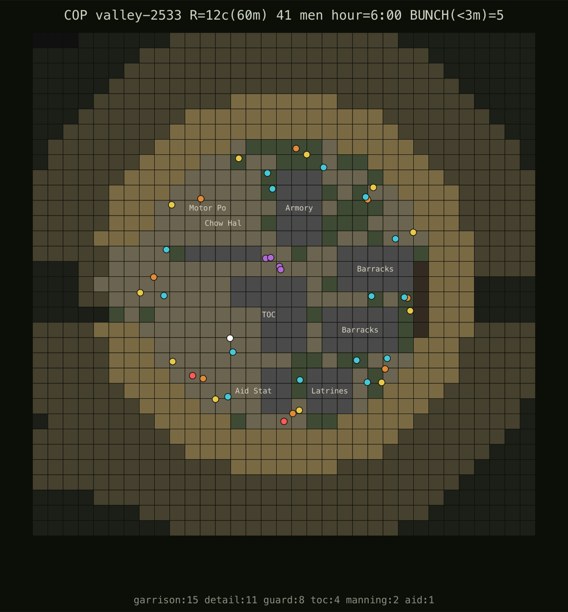
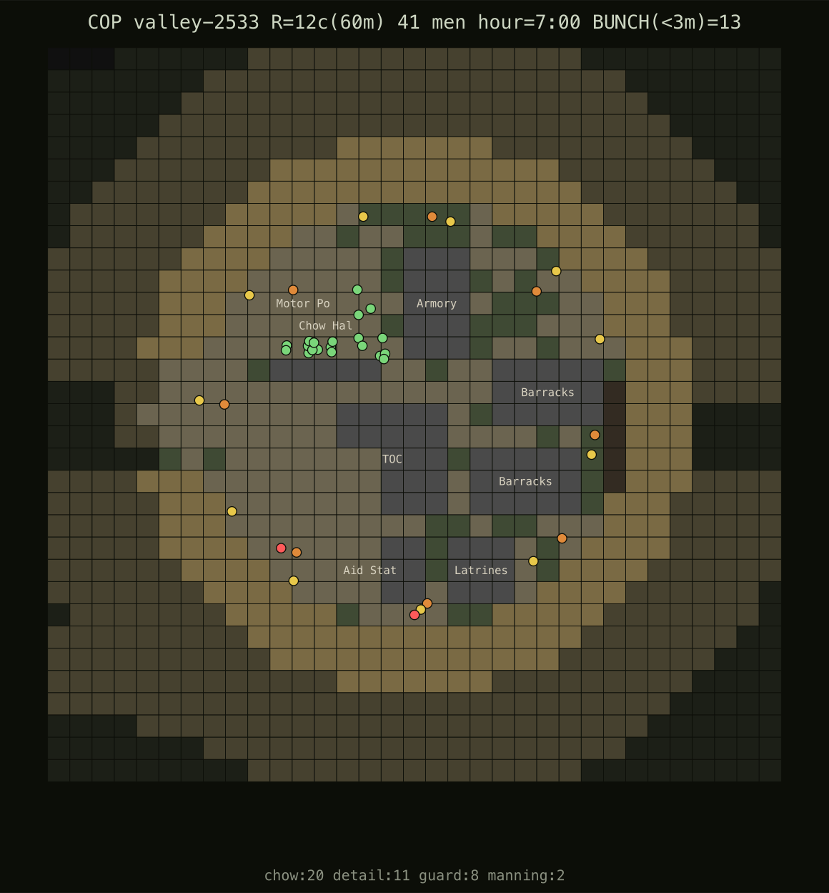

# COP garrison crowding — "soldiers stuck on buildings, too close together"

**2026-06-27.** Player report (speech-to-text): *"I've seen soldiers getting stuck in the COP on
buildings, perhaps too close together… maybe we need to shrink the collider boxes on COP buildings,
this has been very hard to solve."*

This is the second half of issue [012](../../issues/012-cop-interior-connectivity.md). The first half
(2026-06-06) fixed **reachability** — sealed interior pockets a garrison man couldn't path to. That
still holds. This pass fixes **crowding**, and along the way *refutes* the proposed cause (building
colliders) with measurement before touching a line.

## Metricize first — what is actually wrong

| probe | finding |
|---|---|
| `scratch-cop-footprint.ts` | **0 solid-on-solid footprint overlaps**; the negative `minGap` `copinterior` prints is the *passable* Motor Pool clipping the Chow Hall (cosmetic). Every building apron **80–100 % open**. |
| `copinterior.ts 40` | **0/40** unreachable seats/pockets — 012's reachability guarantee holds. |
| `copstuck.ts` | worst offender `maxRun ≤ 1 s`, every "grinding" man moves **25–60 m net** — nobody is trapped; it's incidental wall-brushing in transit. |
| `scratch-cop-men.ts` (new) | settled-garrison render + `BUNCH(<3 m)`: **21–24 / 41 men** shoulder-to-shoulder. Render: ~13 men piled on the two rear barracks; the work detail jammed into one 16° wire corner. |

**Conclusion:** not a collider/footprint problem (nothing boxes anyone in) — a **placement** problem.
After the COP shrank R≈17→**R=12** (issue 014), garrison life was still *jit-onto-a-point* for whole
groups:

- off-duty + sleeping men → **one of two barracks** (`jit 5–9`) → two stacks of ~10 men.
- chow → **20 men jit 5 on the dfac** at meals.
- work detail wire bearing = **`hashId(id) % 360`** — and consecutive member ids hash to consecutive
  values, so all 11 detail men landed in a **16° arc** (confirmed: `scratch-detail.ts` showed bearings
  85–101°, all settled, none blocked).

## The fix — `lib/sim/world/garrison.ts` (placement only; terrain gen byte-identical)

Spread every gathering group by an **even ordinal** — the same idea three times:

1. **`yardSpot()`** — off-duty/rest men fan across the yard on a **golden-angle (phyllotaxis) lattice**
   keyed to platoon index (`rad = wire·(0.20 + 0.54·√frac)`, `ang = i·2.39996`). The golden angle
   spreads *any* subset (the off-duty pool changes as guard rotates); `√frac` gives uniform area
   density; night biases to the rear billets. Reads as a lived-in outpost.
2. **detail** — wire bearing by **ordinal** `((ord+0.5)/n)·2π`, walking the detail around the full
   perimeter (a COP improves the wire everywhere).
3. **`fanAround()`** — chow becomes a loose fanned line at the dfac, not a pile on the building.

Deterministic (platoon index + pure id hash, **zero RNG, no new persisted state**) → replays
bit-identical; the existing `reachablePoint` snap keeps every spot walkable.

## Results

| metric | before | after |
|---|---:|---:|
| `BUNCH(<3 m)` settled garrison — valley-2533 hour 6 | 21 | **5** |
| `BUNCH(<3 m)` — steady (hour 8) / chow (hour 7) | 21 / 24 | **8 / 13** |
| `BUNCH(<3 m)` — survey-44 / korengal hour 6 | 23 / 24 | **5 / 10** |
| detail wire spread | 16° arc, one corner | even, full 360° (bearings 12°/50°/88°…) |
| `copinterior` unreachable seats/pockets (40 seeds) | 0 | **0** (held) |
| `copstuck` grind valley-2533 / survey-44 (600 s) | 67 / 150 | 65 / 119 |

**Before → after (valley-2533, settled garrison, top-down):**

The pile on the two barracks dissolves; the work detail rings the whole wire; chow reads as a queue.

## Honest residual

`copstuck` grind is **~flat** — and that's the point: it counts a man *brushing* a wall in transit
(`maxRun ≤ 1 s`), not the cluster, and the central buildings stay in everyone's path, so it never
measured the owner's complaint. The crowding (`BUNCH`) is the real symptom and it's resolved. The chow
line at a meal hour is still a recognisable (realistic) gathering, not over-dispersed.

## Verification

`tsc` ✓ · `npm run build` ✓ · `smoke` ✓ (no-NaN + serialize round-trip + material hash + determinism)
· `garrison.ts` lint-clean ✓ · `balance` ✓ (combat-neutral by construction — stand-to overrides idle
placement; numbers within the σ≈2.5 noise floor). `campaign-loop` not run: the change is provably
COIN-neutral (idle in-wire placement; cannot affect attitudes/projects/CERP/directives).

Probes added: `scratch-cop-men.ts` (settled-garrison render + BUNCH), `scratch-cop-footprint.ts`
(footprint overlap + apron — refutes the collider theory).
